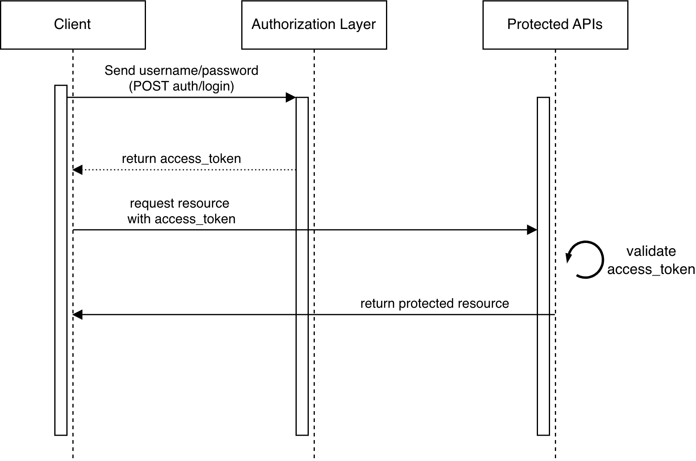

## ProductCatalog API

This project was created to implement the best practices about creating robusts APIs.

#### Stack

- Nodejs - Runtime
  - ExpressJS - Api framework
  - Mongoose - MongoDB schemas and functions
  - Jest - Tests
- :snake: Python - Create fake data
- :whale: Docker - Setup environments
- :four_leaf_clover: MongoDB - Database
- :red_circle: Redis - Security

#### Security

- JWT authentication
- AccessToken + RefreshToken
- Whitelist control of refreshTokens

#### JWT implementation flow comparison

<div align="center">
<p><b>JWT without Refresh Token</b></p>

</div>

#### Documentation

When app is running, go to _/docs_ endpoint.It follows the openapi specification

#### Development Deploy

```bash
docker compose -f docker-compose.yaml up api
```

#### Test Execution

```bash
docker-compose -f docker-compose.yaml up test
```

#### To implement:

- Fake data generator for performance worload tests
- CI/CD

#### Key improvements:

- Validations Can Be More Rigorous (may add email field and validation)
- Input sanitization (express-validator)
- Rate limiting
- Performance metrics
- Structured logs
- Healthcheck
- Set resoruces usage (CPU, RAM...) in compose files
- Two factor authentication
